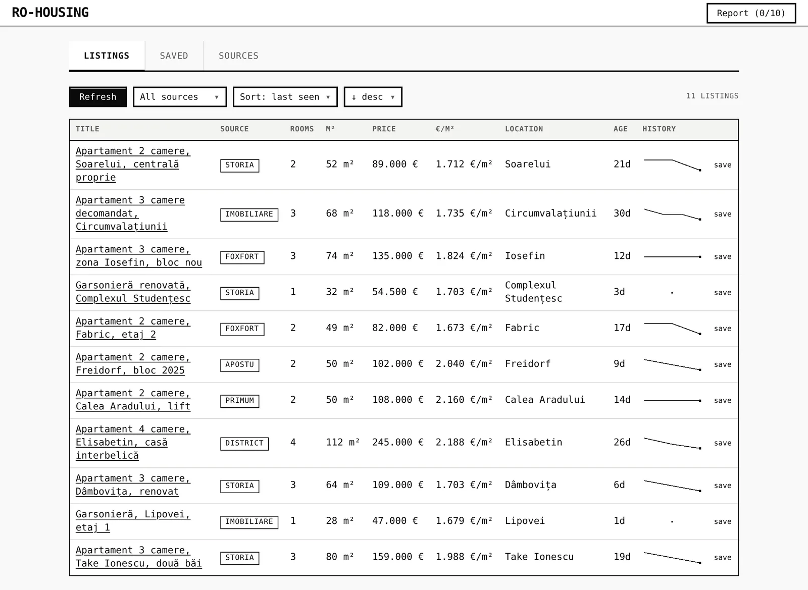
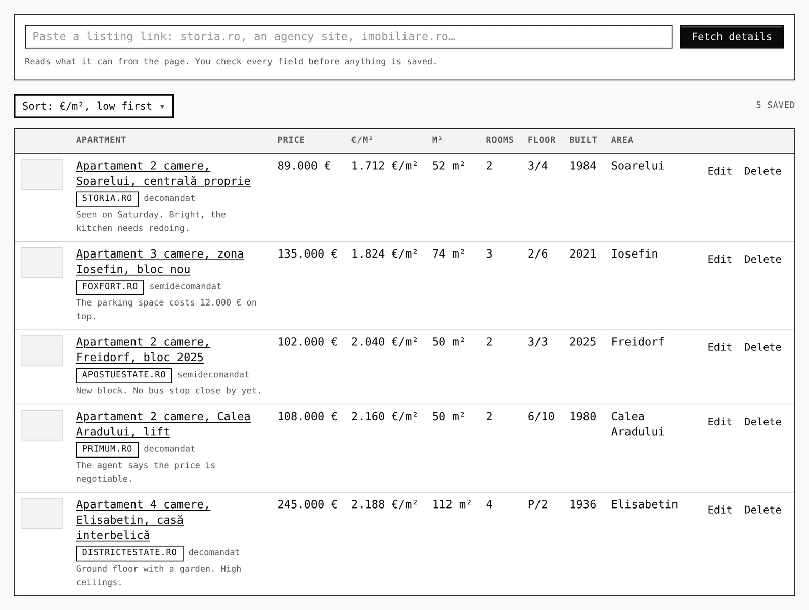
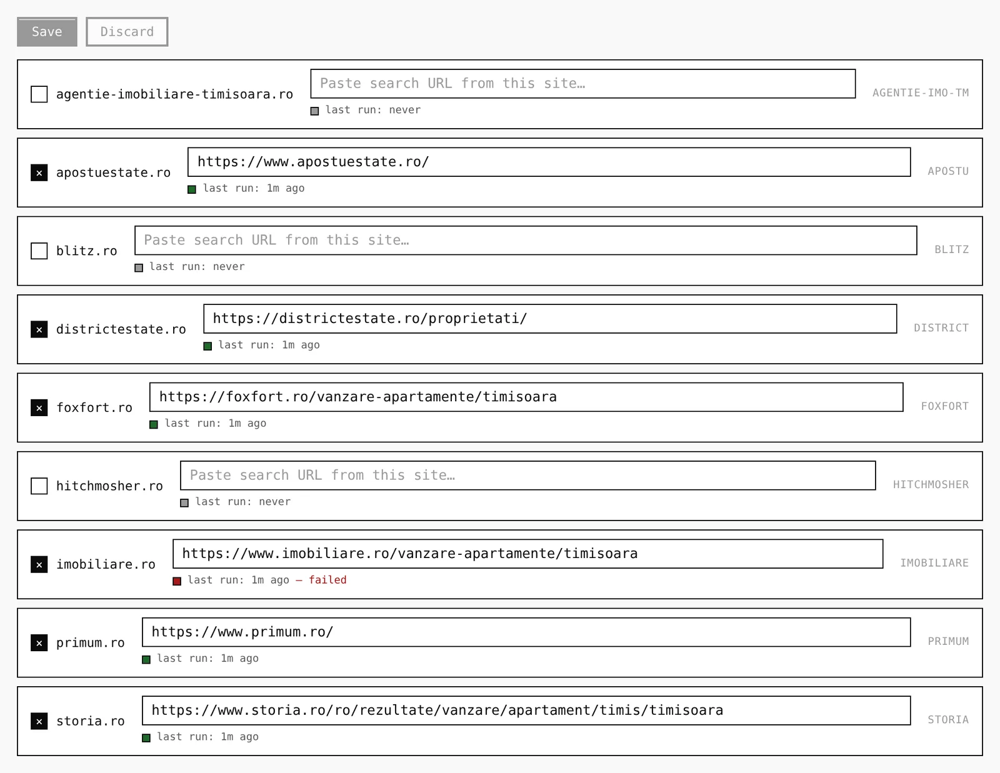
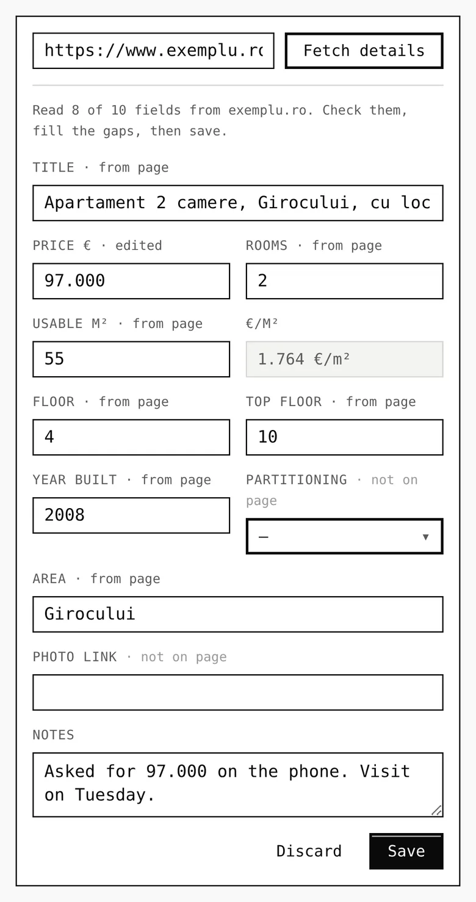
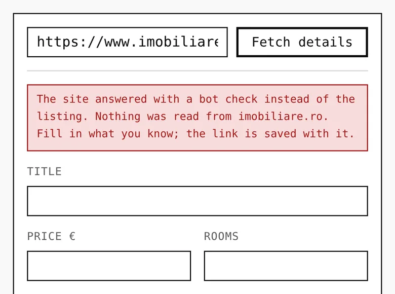
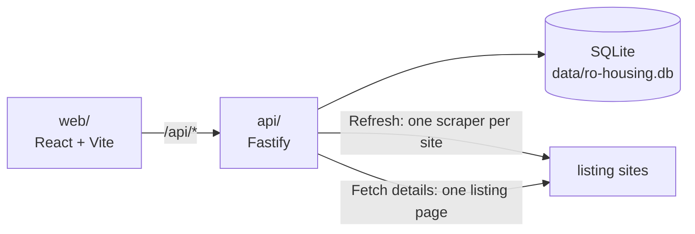

# ro-housing

A house-hunting tool for one person looking to buy a flat in Timișoara. It pulls apartments for sale from imobiliare.ro, storia.ro and seven local agency sites into one table, and keeps a shortlist of the flats you want to compare.

<p align="center">
  
</p>

**Status:** Personal project that runs on your own computer. There is no hosted version. Of the nine search scrapers, only imobiliare.ro's has been checked against the live site, and since 2026-10-16 imobiliare.ro has answered the app with a bot check. Reading single listings works on storia.ro and the three agency sites tried.

## What it does

- Collects listings from up to nine sites into one table you can sort by price, m² or date and filter by site, with €/m² worked out for every row.
- Keeps each listing's price history, one point per Refresh, drawn as a small line beside it.
- Saves one listing from its link. The app reads price, rooms, m², floor, year built, area, partitioning and photo from the page into a form. Each field says "from page", "edited" or "not on page", and nothing is stored until you press Save. When a site shows a bot check instead of the ad, the form opens empty with the link kept.
- Lines up the saved flats with your notes, sorted by price, €/m², m² or year built. You can edit any of them later. Deleting one takes two clicks.

Each listing site shows only its own ads, and a spreadsheet means copying every field by hand. This tool covers one city, one buyer and flats for sale only. It does not merge a flat listed on two sites, refresh on a schedule, or store photos, only links to them.

## Screenshots

| The shortlist, cheapest €/m² first | One search URL per site, with imobiliare.ro's last run failed |
|---|---|
|  |  |

| A pasted link read into a draft | A site that answers with a bot check |
|---|---|
|  |  |

The screens show made-up listings and apartments from [demo-seed.mjs](docs/images/demo-seed.mjs). The draft is a staged answer for `exemplu.ro`, a site that does not exist. The bot check is imobiliare.ro's real answer on 2026-10-16. How each image was made: [docs/images/shots.md](docs/images/shots.md).

## How it works

Two npm packages. `api/` is a Fastify server on SQLite. For Refresh it runs one scraper per site in turn: cheerio on plain HTML, or a headless Chromium driven by Playwright when a site needs a real browser. For a single link it fetches the page, tries the browser if the plain request is refused, and reads the fields with one site-independent extractor: storia's embedded JSON, then Romanian label/value pairs such as "Nr. camere: 3", then the page's Open Graph tags, then phrases like "etajul 3 din 4". `web/` is a React app built with Vite, Tailwind and Base UI. It proxies `/api` to the server.



More in [docs/architecture.md](docs/architecture.md), and how each scraper reads its site in [docs/adapters.md](docs/adapters.md).

## Run it locally

Requires Node 24 and npm. Use two terminals:

```bash
cd api && npm install && npm run dev    # API on http://127.0.0.1:3000. The install also downloads Chromium
cd web && npm install && npm run dev    # web app on http://127.0.0.1:5173
```

Open <http://127.0.0.1:5173>. In **Sources**, tick a site, paste a search-results URL from it and press Save, then press Refresh on **Listings**. In **Saved**, paste one listing's link and press Fetch details. The API creates its database, `data/ro-housing.db`, on the first start. Settings, tests and known problems: [docs/getting-started.md](docs/getting-started.md).

## Project layout

| Path | What lives there |
|---|---|
| `api/` | Fastify server: the database, the nine search scrapers, the single-listing reader, the routes |
| `web/` | React app: the Listings, Saved and Sources tabs, and the shared UI components |
| `data/` | The SQLite file, created on first start, not in git |
| `docs/` | Setup, architecture, the scrapers, decisions, the worklog and the images here |

## Docs

- [docs/](docs/README.md): setup, what the app is and isn't, how it's built, the scrapers, the design system, tests, decisions and the session-by-session worklog

## License

No license yet; all rights reserved.
